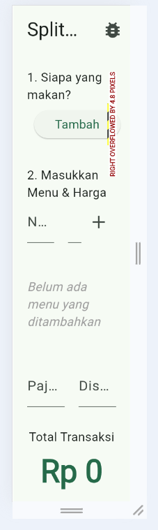
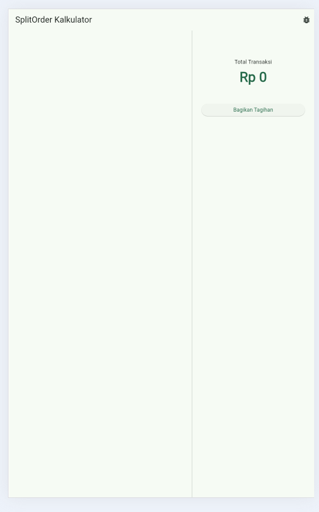
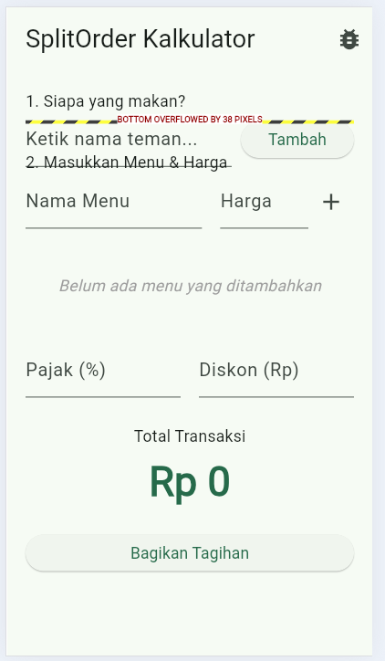

## 1. Right overflowed by 4.8 pixels



   Aturan yang dilanggar adalah ukuran total dari children di dalam row melebihi batas lebar maksimun yang diberikan oleh parentnya saat layar menyempit.
   perbaikan: mengganti row menjadi wrap di class friend input section
   ```dart
   Wrap(
    spacing: 8.0,
    runSpacing: 8.0,
    crossAxisAlignment: WrapCrossAlignment.center,
    children: [
      SizedBox(
      width: 200,
      child: const TextField(decoration: InputDecoration(hintText: 'Ketik nama teman...')),
      ),
      ElevatedButton(onPressed: () {}, child: const Text('Tambah')),
    ],
   )
   ```

## 2. Unbounded Width



Aturan yang di langgar adalah container di berikan lebar `double.infinity` dan di letakkan di row yang kemudian lebarnya menjadi tak terbatas 
perbaikan: memakai widget expanded 
```dart
Row(
    children: [
        const Expanded(child: TextField(decoration: InputDecoration(hintText: 'Ketik nama teman...'))),
        const SizedBox(width: 8),
        ElevatedButton(onPressed: () {}, child: const Text('Tambah')),
    ],
)
```
## 3. Bottom Overflowed



Aturan yang dilanggar adalah total tinggi elemen di dalam `Column` melebihi batas tinggi maksimal yang disediakan, sehingga isinya memanjang ke bawah.
perbaikan: menghapus batasan tinggi 
```dart
Column(
  crossAxisAlignment: CrossAxisAlignment.start,
  children: [
    const Text('1. Siapa yang makan?'),
    Row(
      children: [
        const Expanded(child: TextField(decoration: InputDecoration(hintText: 'Ketik nama teman...'))),
        const SizedBox(width: 8),
        ElevatedButton(onPressed: () {}, child: const Text('Tambah')),
      ],
    ),
  ],
)
```